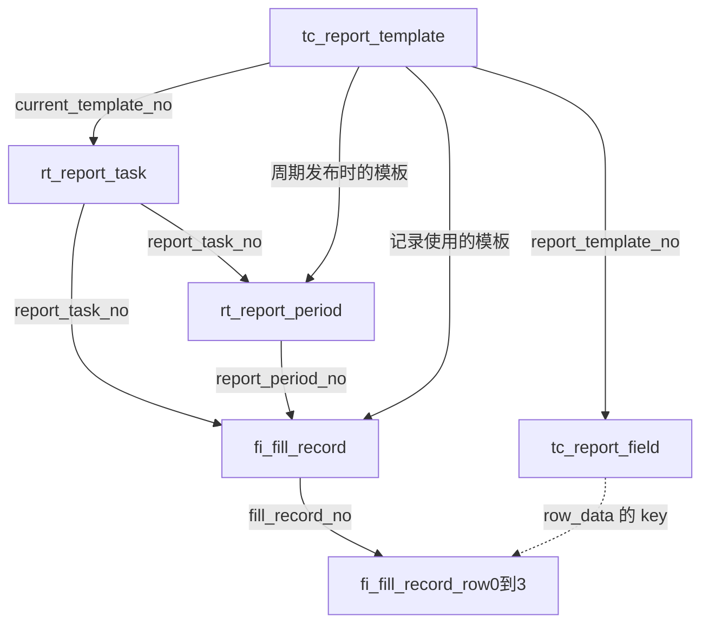
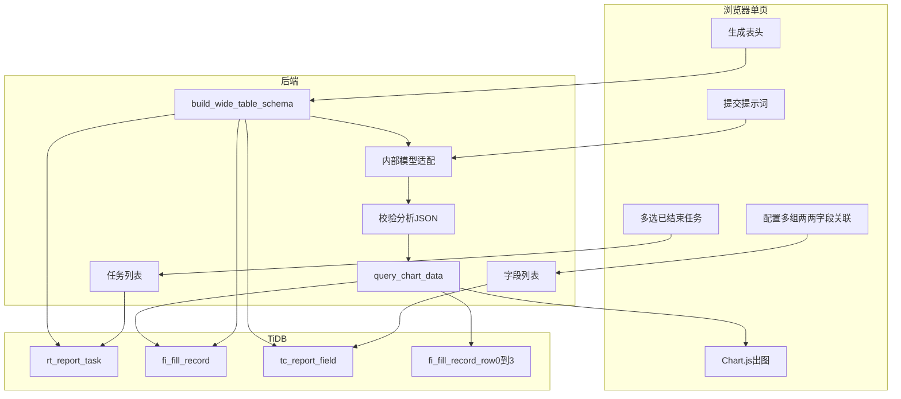
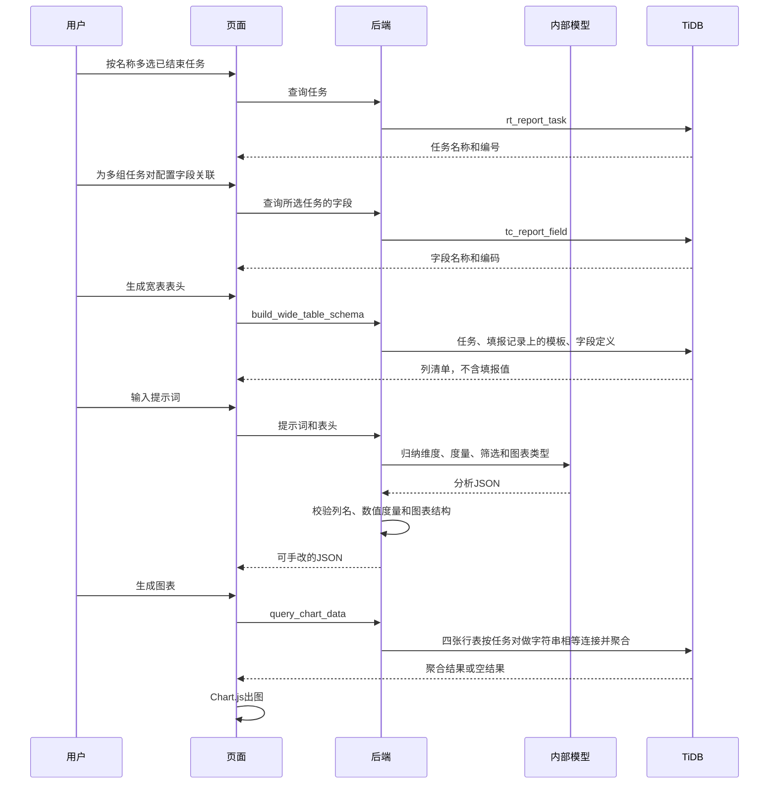

# 填报分析助手调研

日期：2026-10-22

目标是尽快做出一个 Demo：用户从已结束的填报任务里挑选数据，自己指定任务之间怎么对齐，再用语自然语言说明想看的图。助手只根据这些输入查数并出图。

## 1. 数据源

库是 TiDB v8.5.3，库名 `data_flow`。连接信息只放环境变量，不写进代码和本文档。

库内 25 张基表，没有视图、存储过程，也没有声明外键。表之间用 `*_no` 业务主键关联。账号口令、主机不在本文展开。

已结束任务的范围是 `rt_report_task.task_status = 'COMPLETED'` 且 `delete_flag = 0`。调研时这类任务有 16 条。另有进行中 117 条、草稿 2 条、已逻辑删除 20 条。Demo 不使用后三类。

## 2. 填报结果放在哪里

公式结果没有单独的结果表。用户填写值和公式计算结果写在同一份行 JSON 里。

一条填报对应 `fi_fill_record`。每一行落在 `fi_fill_record_row0` 到 `fi_fill_record_row3` 四张结构相同的分表。`row_data` 的 key 是 `field_code`，value 是字符串。`field_kind = ORIGINAL` 的 key 是手填值，`DERIVED` 的 key 是已经算完并按 `decimal_places` 舍入后的结果。

字段含义在 `tc_report_field`。`formula` 是计算式，`formula_label` 只给前端展示。读宽表时直接取 `row_data`，不再重算公式。

`warning_result` 是预警命中，不是计算结果。沉淀后的异常台账在 `re_exception_record`。Demo 不使用这两处。

用任务「甲方垃圾费」核对过：模板字段是序号、严重、注意、提示，第 1 行的 `row_data` 里能直接取出这四个值。

## 3. 主表关系

模板决定填什么，任务决定谁在什么周期填，填报记录保存实际内容。任务上的 `current_template_no` 会在字段变更后指向新模板，所以周期和填报记录各自再存一份当时的 `report_template_no`。取字段定义时用填报记录上的模板编号。



## 4. 已确认的产品规则

- 筛选框只放已结束任务，按名称多选，提交 `report_task_no`。
- 用户在两个任务里任意各选字段，按填报值字符串完全相等对齐。程序不判断字段能不能对上。对不上就是没有数据。
- 关联按两两任务分组。可以同时存在多组，例如 A 对 B、A 对 C、B 对 C。每一组里可以有多条字段关联。
- 同一组里的多条字段关联是这一对任务自己的对齐条件，要同时满足。不同组是不同的连接边，不收成一条总条件。
- 只选一个任务时不需要关联。选了多个任务但某个任务没有进入任何一组时，取数返回空结果，并提示还没有关联条件。
- 第 3 步只生成宽表表头，不读 `row_data`。第 5 步才取数。
- 大模型使用公司内部接口。地址和调用方式尚未提供。模型只产出分析 JSON，不直接写 SQL。JSON 在页面上可核对、可手改。
- 图表先支持柱状图、折线图、饼图。柱状图和折线图是一个维度加一个或多个度量；饼图是一个维度加一个度量。

## 5. 模块

五个区块在同一页从上到下排列。字段对齐由用户点选，不交给模型自由发挥。

1. 任务筛选：列出已结束任务的名称、组织或项目、数据时间。
2. 关联配置：先确定一对任务，再为这一对添加一条或多条字段对齐。组内条件和整组都可以删除。
3. 宽表表头：调用 `build_wide_table_schema`，只返回列名、类型和是否关联键。
4. 分析意图：提示词交给内部模型，收成统一 JSON。
5. 图表：按 JSON 调用 `query_chart_data`，用 Chart.js 出图。没有匹配行时提示「关联条件没有匹配到数据」。

## 6. 技术实现流程

页面先收集任务和关联，这两步不经过模型。表头和取数是两个后端函数，页面直接调用。内部模型接入后，这两个函数同时注册成 function。模型看到的只有表头和提示词，服务端校验列名后再拼只读查询。



一次完整操作的顺序如下。



## 7. 两个函数

`build_wide_table_schema` 只查任务、填报记录和 `tc_report_field`。模板编号用该任务填报记录上的 `report_template_no`。列标识是 `{report_task_no}.{field_code}`。返回列清单和关联条件，不返回填报值。

关联结构：

```json
{
  "pairs": [
    {
      "left_task_no": "任务A",
      "right_task_no": "任务B",
      "links": [
        {"left_field_code": "字段1", "right_field_code": "字段2"}
      ]
    }
  ]
}
```

`query_chart_data` 的取数规则：

- 每个任务把 `fi_fill_record_row0` 到 `row3` 合成行，用 `JSON_UNQUOTE(JSON_EXTRACT(...))` 取出字段。
- 每一组两两关系对应一次 INNER JOIN。同一组里的多条字段关联都是这一次 JOIN 的相等条件。
- 关联键按字符串比较，不做类型转换。`"12"` 和 `"12.0"` 视为不相等。
- 筛选作用在聚合前。维度做 `GROUP BY`。度量只允许 `data_type = NUMBER`，聚合为 `sum`、`avg` 或 `count`，聚合时再把字符串转成数值。

分析 JSON 只能引用表头里的 `column_id`。未知列、非数值度量、和图表类型不匹配的结构由服务端拒绝。

```json
{
  "dimensions": [{"column_id": "任务编号.字段编码"}],
  "measures": [{"column_id": "任务编号.字段编码", "agg": "sum"}],
  "filters": [{"column_id": "任务编号.字段编码", "op": "eq", "value": "12"}],
  "chart": {
    "type": "bar",
    "category": "任务编号.字段编码",
    "series": ["任务编号.字段编码"]
  }
}
```

筛选操作符先做 `eq`、`gt`、`lt`、`contains`。

## 8. 实现落点

Demo 分两段。

第一段是独立 HTML 页面，不连接数据库。16 条已结束任务的名称和字段写在页面里，用来看筛选、多组关联、表头、JSON 和 Chart.js 的版式。图表数字标注为示意。

第二段是连库实现，放在本仓库：

- `app/main.py`：页面和只读接口。
- `app/db.py`：TiDB 连接。
- `app/functions.py`：`build_wide_table_schema` 与 `query_chart_data`。
- `app/llm.py`：内部模型适配层，接口未到之前留配置位。
- `static/index.html` 与 `static/app.js`：向导页面和 Chart.js。
- `.env.example`：数据库和模型配置样例，不含真实口令。

## 9. 尚未提供的输入

公司内部模型的地址、鉴权方式和是否支持 function calling 还没有给到。适配层按「输入表头加提示词，输出第 7 节的 JSON」来包。接口形式不同时只改 `app/llm.py`。

## 10. 这次不做

不建物理宽表，不写回数据库，不分析进行中或草稿任务，不自动推荐关联字段，不重算衍生字段，不读取预警和异常台账，不支持导出。
